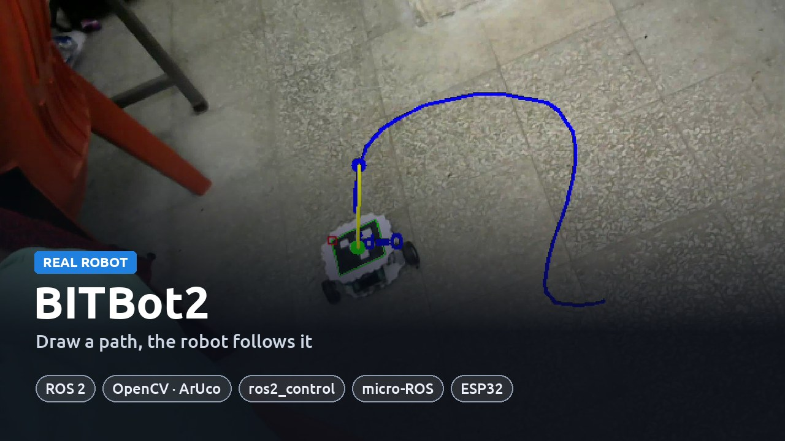
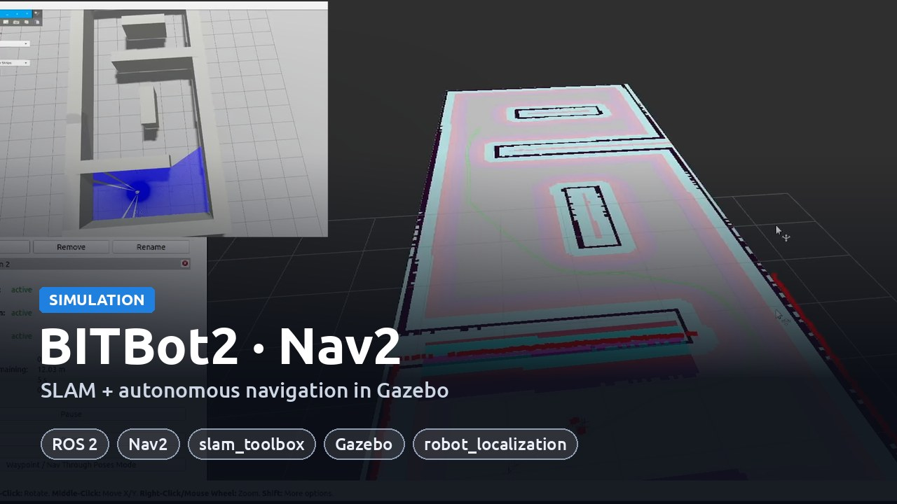
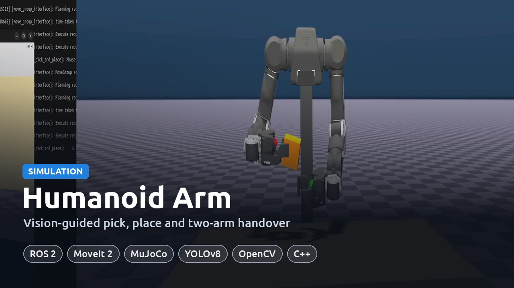
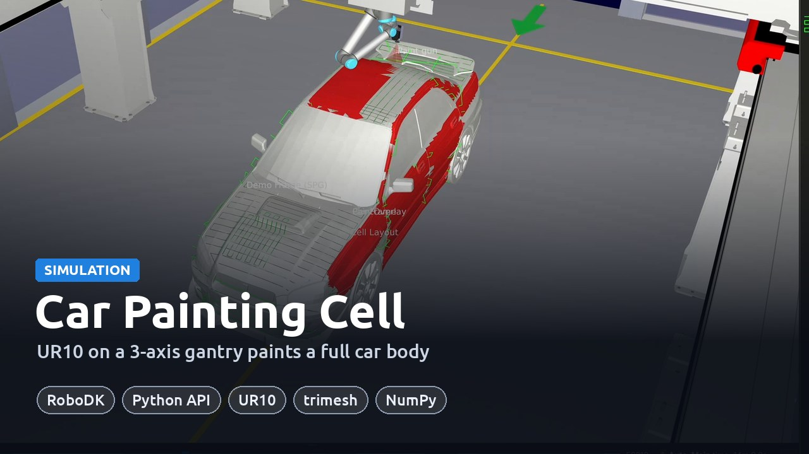

<!-- Header -->
<p align="center">
  
</p>

<p align="center">
  <a href="https://github.com/kk-Dollar">
    
  </a>
</p>

<p align="center">
  <a href="https://www.linkedin.com/in/krishna-pandit-614b2631a/"></a>
  <a href="mailto:krishna.pandit.career@gmail.com"></a>
  
</p>

---

### 🤖 About me

```yaml
name:      Krishna Pandit
studying:  BIT Mesra
building:  autonomous mobile robots and learning-based manipulation
stack:     [ROS 2, Nav2, MoveIt 2, Gazebo, MuJoCo, PyTorch]
exploring: [Vision-Language-Action models, Reinforcement Learning, Imitation Learning]
from_low_level_to_high_level: ESP32 firmware -> micro-ROS -> ROS 2 -> robot learning
```

### 🎬 Project demos

**🤖 Mobile robots**

<p align="left">
  <a href="https://github.com/kk-Dollar/Projects_demo/blob/main/bitbot2/README.md#1-draw-a-path-opencv--aruco"></a>
  <a href="https://github.com/kk-Dollar/Projects_demo/blob/main/bitbot2/README.md#2-autonomous-navigation-nav2-in-gazebo"></a>
</p>

**🦾 Manipulation**

<p align="left">
  <a href="https://github.com/kk-Dollar/Projects_demo/blob/main/humanoid_arm/README.md"></a>
  <a href="https://github.com/kk-Dollar/Projects_demo/blob/main/car_painting_cell/README.md"></a>
</p>

<p align="center"><a href="https://github.com/kk-Dollar/Projects_demo"><b>▶ All demos</b></a></p>

### 🧭 What I work on

| | Area | What I do |
|:-:|---|---|
| 🗺️ | **Navigation** | ROS 2 Nav2 bring-up from scratch: map_server, AMCL, planners, controllers, costmaps, behaviour trees |
| 🦾 | **Manipulation** | Arm kinematics, pick-and-place, MoveIt 2 motion planning |
| 🧠 | **Robot learning** | Imitation learning (ACT), reinforcement learning from first principles, VLA models |
| ⚡ | **Embedded** | ESP32 / ESP-IDF firmware, micro-ROS, custom wheeled robots and robot arms |

### 🚀 Featured projects

| Project | Description | Stack |
|---|---|---|
| [**Robot-Imitation-Learning**](https://github.com/kk-Dollar/Robot-Imitation-Learning) | Action Chunking Transformer (ACT) policy for learning manipulation from demonstrations | Python · PyTorch |
| [**Humanoid_arm**](https://github.com/kk-Dollar/Humanoid_arm) | 7-DOF arm doing pick-and-place in a MuJoCo world | Python · MuJoCo |
| [**Car-painting-robot**](https://github.com/kk-Dollar/Car-painting-robot) | Robotic car-painting cell: UR10 arm on a 3-axis gantry, simulated in RoboDK | Python · RoboDK |
| [**sutton-and-barto-from-scratch**](https://github.com/kk-Dollar/sutton-and-barto-from-scratch-1-bandits-and-dynamic-programming) | Multi-armed bandits and dynamic programming, implemented from Sutton & Barto | Python · RL |
| [**level01_ros_assignment**](https://github.com/kk-Dollar/level01_ros_assignment/tree/krishna/nav2-assignment) | Manual Nav2 bring-up (map_server, AMCL, NavFn, DWB) for a differential-drive robot in Gazebo | ROS 2 · Nav2 · Gazebo |
| [**Learning-ROS2**](https://github.com/kk-Dollar/Learning-ROS2) | Working through ROS 2 for robotics programming | C++ · ROS 2 |
| [**ServoX**](https://github.com/kk-Dollar/ServoX) · [**Vector**](https://github.com/kk-Dollar/Vector) · [**NOXBOT**](https://github.com/kk-Dollar/NOXBOT) | 3-DOF robot arm, 2-wheel and 4-wheel robots, firmware in C | C · ESP32 |

### 🛠️ Tech stack

<p align="center">
  
</p>

<p align="center">
  
  
  
  
  
  
  
</p>

### 📊 GitHub stats

<p align="center">
  
  
</p>
<p align="center">
  
</p>
<p align="center">
  
</p>

---

<p align="center">
  <i>"A robot is only as good as its weakest frame transform."</i>
</p>

<p align="center">
  
</p>
